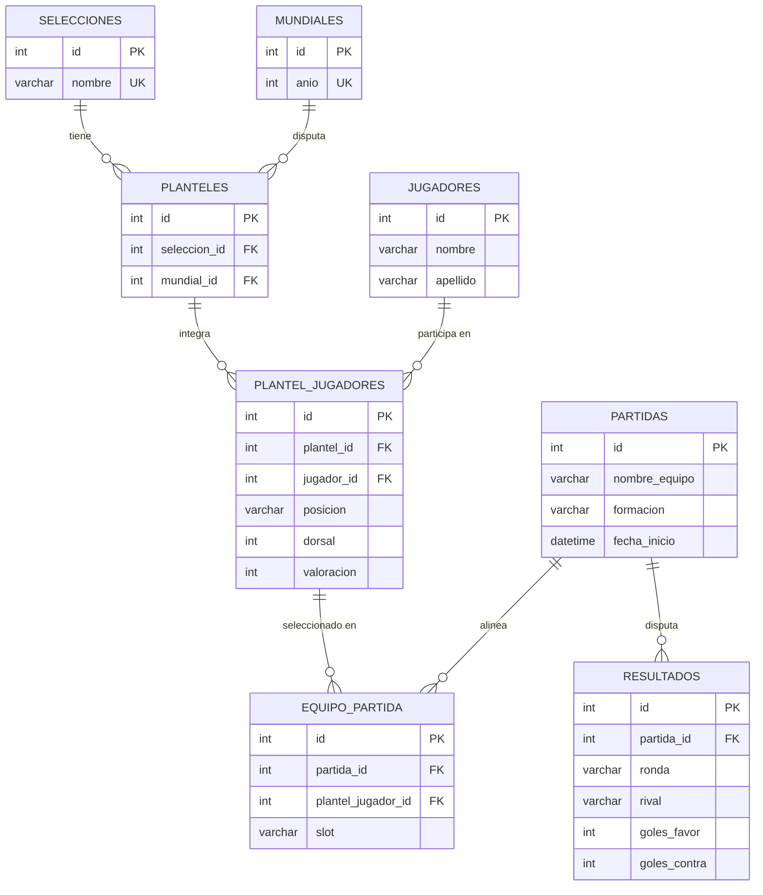

# Diagrama Entidad-Relacion (DER) - Draft Mundialista

## 1. Modelo Relacional

El sistema modela selecciones, ediciones de mundiales, planteles históricos, jugadores individuales, la participación específica de un jugador en dicho plantel con sus valoraciones (01 al 99), y el registro del juego (partidas, equipo armado por slots y resultados de los partidos simulados).

## 2. Descripción de Tablas y Justificación

1. **selecciones**: Almacena cada país participante sin redundancias.
2. **mundiales**: Almacena cada edición de copa del mundo (ej. 1986, 2002, 2022).
3. **planteles**: Relaciona una selección con un mundial determinado (N:M resuelta con clave única combinada `UNIQUE(seleccion_id, mundial_id)`).
4. **jugadores**: Contiene los datos personales de la persona (`nombre`, `apellido`). Un jugador puede haber jugado en múltiples mundiales (ej. Messi 2006, 2014, 2022).
5. **plantel_jugadores**: Entidad intermedia que asigna al jugador en un plantel específico con sus datos deportivos en ese momento: `posicion`, `dorsal` y `valoracion` (01 a 99). Clave única `UNIQUE(plantel_id, jugador_id)`.
6. **partidas**: Representa la sesión o partida iniciada por el usuario, almacenando el nombre de su equipo y su formación táctica (ej. 4-3-3).
7. **equipo_partida**: Asocia los jugadores seleccionados durante el draft a cada posición (`slot`) de la cancha táctica. Restricciones `UNIQUE(partida_id, slot)` y `UNIQUE(partida_id, plantel_jugador_id)` para garantizar que un puesto no tenga dos jugadores ni se elija dos veces al mismo futbolista.
8. **resultados**: Guarda el historial de enfrentamientos simulados en el torneo (ronda, rival histórico, goles a favor y goles en contra).
